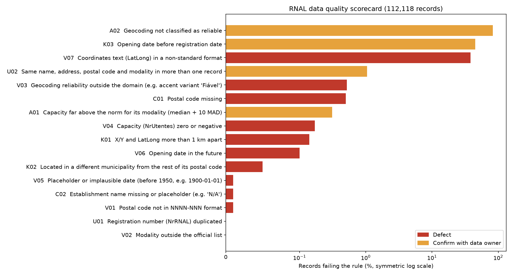
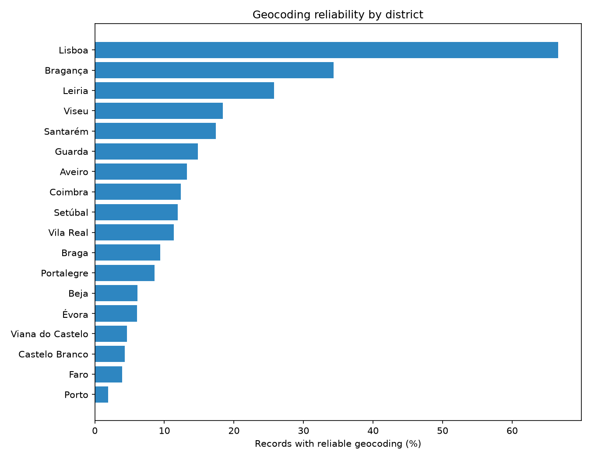

# Data Quality Audit: Portugal's Local Accommodation Register

A reproducible data quality audit of the **Registo Nacional de Alojamento Local (RNAL)**, the official register of short-term rental establishments in Portugal (112,118 records, open data from Turismo de Portugal, extract of 12 Nov 2026).

The audit applies 16 rules across five quality dimensions, separates **confirmed defects** from **patterns that need confirmation from the data owner**, and cross-checks the register against itself and against postal codes, the way a land or property registry is audited before it is used for planning, taxation or inspections.



## Why this register

Municipalities and the tourism authority use the RNAL to plan inspections, study housing pressure and publish statistics. If coordinates, capacities or dates are wrong, those decisions inherit the error. The checks here come from my day-to-day work auditing municipal property registers: completeness of key fields, keys and duplicates, coordinates that disagree with the declared address, and values that are technically valid but implausible.

## Key findings

| # | Finding | Records |
|---|---|---|
| 1 | **Only 17% of the records have geocoding classified as reliable** (`Fiavel`). The rest are flagged by the publisher as unreliable or low reliability. In Lisbon the reliable share is 67%; in Porto and Faro, below 5%. | 92,647 |
| 2 | The same reliability flag appears in **two spellings** (`Fiavel` and `Fiável`), so any filter on `Fiavel` silently drops 585 reliable records. | 585 |
| 3 | The location is stored twice (X/Y and a `LatLong` text). The text field comes in **at least four formats** (comma or dot as decimal mark, with or without spaces), and in 153 records the two locations are **more than 1 km apart**. | 42,868 / 153 |
| 4 | **Capacity of zero guests** in 189 establishments; capacities far above the norm for the modality, such as an apartment for 118 guests. | 189 / 347 |
| 5 | **Placeholder and impossible dates**: registrations on 1900-01-01 and opening dates as late as 2033. | 12 / 109 |
| 6 | **1,172 records** share name, address, postal code and modality with another record: candidates for duplicate registration. | 1,172 |
| 7 | 61 establishments sit in a **different municipality from the rest of their postal code**. | 61 |
| 8 | 565 records have **no postal code**; 7 have malformed ones (`4400617`, `330`, a code repeated four times in one field). | 572 |

Excluding the coordinate-text format rule, **1,692 records (1.5%) have at least one confirmed defect**.

**A finding about the data model:** the parish code (`DTMNFR`) matches the parish where the coordinates fall in 100% of the records, checked against the official boundaries (CAOP 2025). That means the parish was most likely **derived from the coordinates** rather than declared, so it cannot be used to validate them. The postal code is an independent field, and rule K02 uses it for that cross-check instead.



## Rules

| Code | Dimension | Rule | Status |
|---|---|---|---|
| C01 | Completeness | Postal code missing | Defect |
| C02 | Completeness | Establishment name missing or placeholder (`N/A`, `-`) | Defect |
| V01 | Validity | Postal code not in `NNNN-NNN` format | Defect |
| V02 | Validity | Modality outside the official list | Defect |
| V03 | Validity | Geocoding reliability outside the domain | Defect |
| V04 | Validity | Capacity zero or negative | Defect |
| V05 | Validity | Placeholder or implausible date (before 1950) | Defect |
| V06 | Validity | Opening date in the future | Defect |
| V07 | Validity | `LatLong` text in a non-standard format | Defect |
| U01 | Uniqueness | Registration number duplicated | Defect |
| U02 | Uniqueness | Same name, address, postal code and modality | Confirm with data owner |
| K01 | Consistency | X/Y and `LatLong` more than 1 km apart | Defect |
| K02 | Consistency | Municipality differs from ≥ 90% of its postal code | Defect |
| K03 | Consistency | Opening date before registration date | Confirm with data owner |
| A01 | Accuracy | Capacity above median + 10 × MAD for the modality | Confirm with data owner |
| A02 | Accuracy | Geocoding not classified as reliable | Confirm with data owner |

**Why some rules are "confirm with data owner":** 45% of the establishments have an opening date earlier than their registration date (K03). That is probably legitimate, since many establishments existed before the registration regime, but only the data owner can confirm it. Flagging it as an error without that conversation would be wrong. The same applies to large capacities (a hostel for 310 guests may be real) and to possible duplicates (several units in the same building may share a name).

## Python and SQL cross-validation

The rules are implemented twice, in Python (pandas) and in PostgreSQL/PostGIS, and the two scorecards were compared on the same extract loaded into a local PostgreSQL 17 + PostGIS 3.6 database. **All 16 rules returned identical counts**, after one fix that the comparison itself exposed:

- The first run disagreed on C02 (missing name): Python found 8, SQL found 0.
- The 8 records have the literal name `N/A`. **pandas silently converts the string "N/A" into a missing value by default**, while PostgreSQL keeps it as text.
- The fix makes both sides explicit: pandas now reads raw values (`keep_default_na=False`), and C02 treats placeholders (`N/A`, `-`, `null`...) as missing in both implementations. That also caught 3 names filled with `-`. Final count: 11 in both.

## Project structure

```text
src/rules.py              16 rules, each returning the records that fail
src/run_quality.py        runs the rules, writes the scorecard, per-record failures and figures
tests/test_rules.py       unit tests on synthetic records (pytest)
sql/load_rnal_postgresql.sql   loads the CSV into PostgreSQL (all columns as text)
sql/checks_postgresql.sql      the same rules in PostgreSQL/PostGIS, one query per rule (failing records)
sql/scorecard_postgresql.sql   one query with the count of every rule, to compare with Python
results/                  scorecard.csv, failures_by_record.csv, by_district.csv
figures/                  scorecard and geocoding charts
```

`failures_by_record.csv` lists only the public registration number, municipality, district and failed rules. **Names and street addresses are never written to the outputs**, because many establishments are registered under a private person's name.

## How to run

```bash
python -m venv .venv
.venv\Scripts\activate            # Linux/macOS: source .venv/bin/activate
pip install -r requirements.txt

# Download the CSV from dados.gov.pt ("Estabelecimentos de Alojamento Local", Turismo de Portugal)
python src/run_quality.py path/to/al.csv --reference-date 2026-11-13
pytest
```

**SQL version** (PostgreSQL 17+ with PostGIS): run `sql/load_rnal_postgresql.sql` with psql from the folder that contains the CSV, then `sql/scorecard_postgresql.sql`. The counts should match `results/scorecard.csv`.

## Data

- **Estabelecimentos de Alojamento Local**, Turismo de Portugal, via [dados.gov.pt](https://dados.gov.pt/pt/datasets/estabelecimentos-de-alojamento-local-1/), licence CC BY 4.0. The extract covers the 18 mainland districts.
- **CAOP 2025** (official administrative boundaries), Direção-Geral do Território, used to check parish codes against coordinates.

## Next steps

- Reverse-geocode the postal code against the official postal-code polygons (not openly available) to replace the majority-based rule K02.
- Track the scorecard over successive extracts to see whether issues are being fixed or accumulating.
- Schedule the SQL checks to run on every new extract and alert when a rule's failure rate jumps.

## Stack

Python · pandas · GeoPandas · pytest · Matplotlib · SQL (PostgreSQL/PostGIS)
